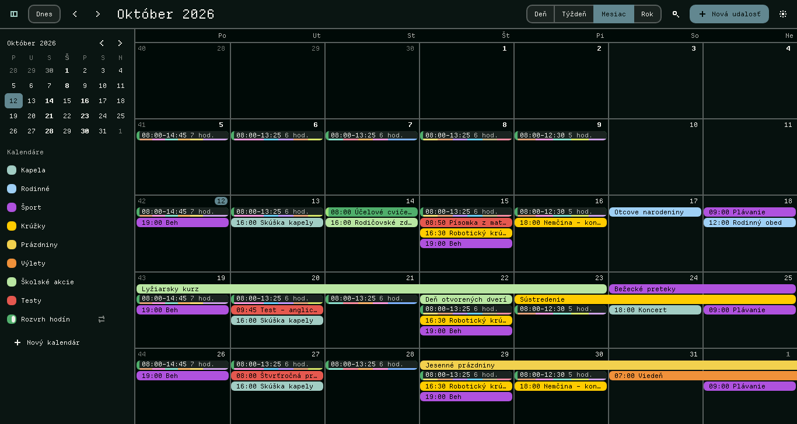
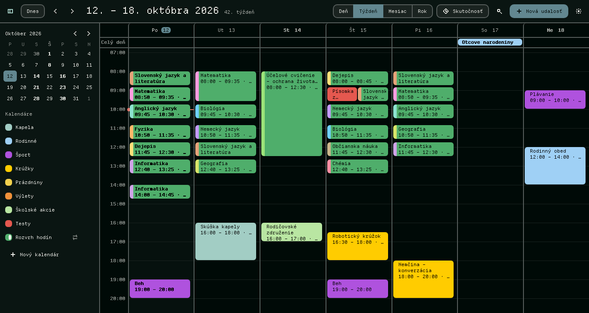
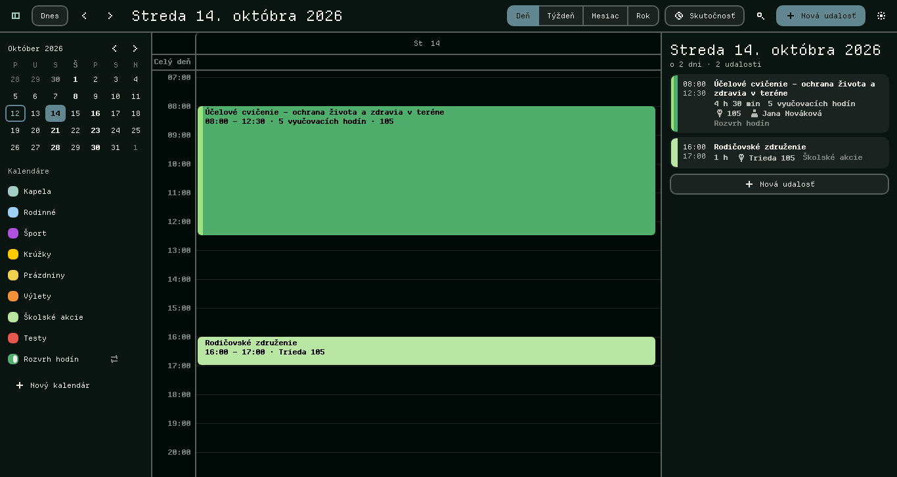
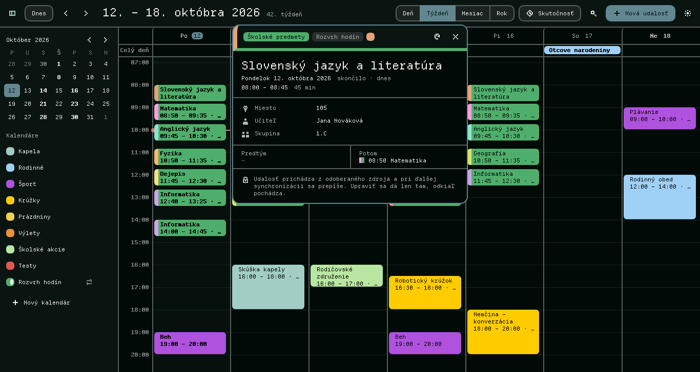
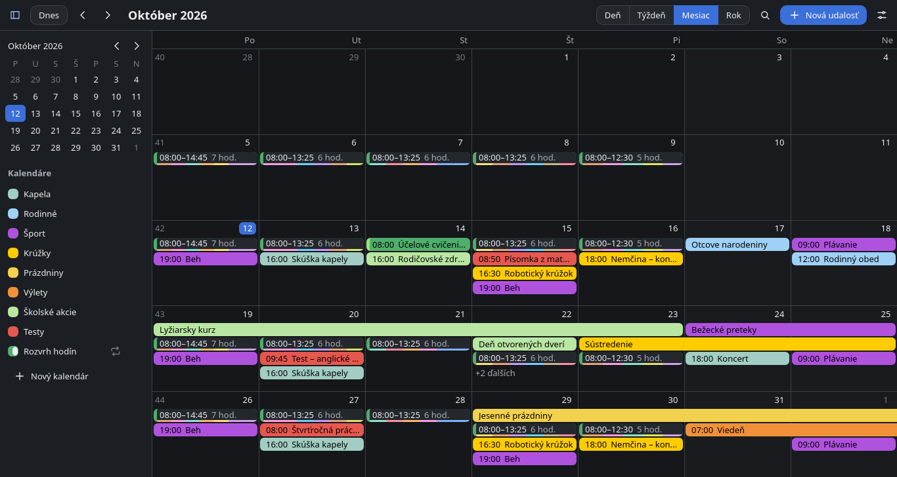

<div align="center">


# Kalendarix

**Your calendar. Your phone. Your rules.**

A local-first desktop calendar that keeps your events in one file on your
machine, shows them clearly, and can hand them to a feature phone over a cable.

</div>



| | |
|---|---|
|  |  |
|  |  |

<sub>Made-up sample data, in the pixel look (and the built-in dark theme, bottom right).</sub>

## What it does

- **Year, month, week and day.** An event that covers several days is one bar
  across them. Clicking a day opens that day: its hours, and everything in it as
  a list.
- **Categories with fixed colours.** A calendar says what kind of thing it holds
  (school subjects, tests, trips… or a kind of your own, made in the settings)
  and that kind always has the same colour. An event can carry a **second
  colour** of its own, so every subject of a timetable is "school" and still
  tells itself apart.
- **Details worth opening.** What an event is and which kind, when and how far
  off, where, with whom, what comes before and after it. Lines such as
  `Učiteľ: …` in a feed's description become labelled rows.
- **Lives with other programs.** `calendars.json` can be shared with a
  timetable sync or a calendar in the desktop's panel: Kalendarix picks up
  their changes while open and never saves over them. The layout is written
  down in [docs/calendars-json.md](docs/calendars-json.md).
- **At home on a tiling desktop.** One instance, no tray, no title bar under
  Hyprland or Sway, usable in a narrow column, and a small calendar for under
  the bar (`kalendarix --bar-popup`). It wears the desktop's palette, including
  the pixel look of a bitmap-font desktop. See [docs/hyprland.md](docs/hyprland.md).
- **iCalendar in and out.** Import `.ics` files, subscribe to an `.ics` address,
  export calendars.
- **Export to feature phones.** Nokia Series 40 and S60, Sony Ericsson, Motorola,
  Samsung, Siemens: each gets the format, encoding and field lengths it can
  take, as a `.vcs` file pushed over USB with [gammu](gammu/README.md).
- **Slovak and English.**

## Keys

| Key | |
|---|---|
| `D` `W` `M` `Y` | day, week, month, year |
| `←` `→` | back, forward |
| `T` | today |
| `N` | new event |
| `Ctrl+K` or `/` | search |
| `Esc` | close what is open |

In the week and day views a double-click on an empty spot creates an event
there, and an event can be dragged to another time or day.

## Build and run

Kalendarix is a [Tauri](https://tauri.app) app: a small Rust shell
(`src-tauri/`) around an interface written in TypeScript (`src/`).

The tools that read the TypeScript are Rust as well: it is type-checked by
[tsc-rs](https://github.com/pingdotgg/ts-rust), a Rust port of the TypeScript 7
compiler, bundled by Vite (Rolldown and Oxc) and linted by oxlint. The
`typescript` package is not used.

You need Node.js 24 or newer, Rust (stable), and on Linux the WebKitGTK 4.1
development files:

```bash
# Arch
sudo pacman -S --needed webkit2gtk-4.1 base-devel
# Debian, Ubuntu
sudo apt install libwebkit2gtk-4.1-dev build-essential libssl-dev librsvg2-dev libxdo-dev
```

```bash
npm install
npm run tauri dev                    # the app, reloading as you edit
npm run tauri build -- --no-bundle   # src-tauri/target/release/kalendarix
npm run tauri build                  # installers for this platform
```

At run time it needs `webkit2gtk-4.1` and nothing else. An Arch package recipe
is in [packaging/arch](packaging/arch).

### Working on the interface alone

```bash
npm run dev      # http://127.0.0.1:1420 in any browser
```

Outside the app the interface runs against a stand-in backend (localStorage and
sample calendars), so nothing of the above has to be built. `?theme=pixel`
shows the pixel look, `?actual` the tracked-activity lane, `?demo=0` starts empty.

### Checks

```bash
npm run check                 # types, lint, unit tests
npm run e2e                   # the interface in a real browser (needs npm run dev)
KX_BROWSER=webkit npm run e2e # the same in WebKit, the engine the app runs on under Linux
cd src-tauri && cargo test && cargo clippy --all-targets -- -D warnings
```

`npm run e2e` leaves a screenshot of every state in `e2e/shots/`. It is a
TypeScript file that Node runs as it is.

tsc-rs is young, so `package.json` names one exact version of it. Its install
script is declined there (`allowScripts`): it only makes the command start a
little faster.

## Where things are

```
src/core/       the calendar itself, no window needed: dates, recurrence, categories and colours,
                layout of the grids, the calendars.json document, iCalendar, phone export
src/state/      the app's state and theme
src/ui/         the interface (Preact)
src/platform/   the line between interface and shell, with a browser stand-in
src-tauri/      the shell: files, windows, single instance, desktop palette
e2e/            browser checks
docs/           the file format, running under Hyprland
gammu/          scripts that push an exported file to a phone
```

## Files

| | |
|---|---|
| `~/.config/kalendarix/calendars.json` | calendars and events |
| `~/.config/kalendarix/settings.json` | language, look, last choices |
| `~/.config/kalendarix/theme.toml` | optional palette of your own |
| `~/.config/kalendarix/calendars.json.before-v2` | the calendars as they were before 2.0 first wrote them |

## License & brand

Source code: [MIT](LICENSE). The **Kalendarix name, logo, and brand are
reserved**; see [BRANDING.md](BRANDING.md). Forks must rebrand.

---

<div align="center"><sub>Made by esyst</sub></div>
